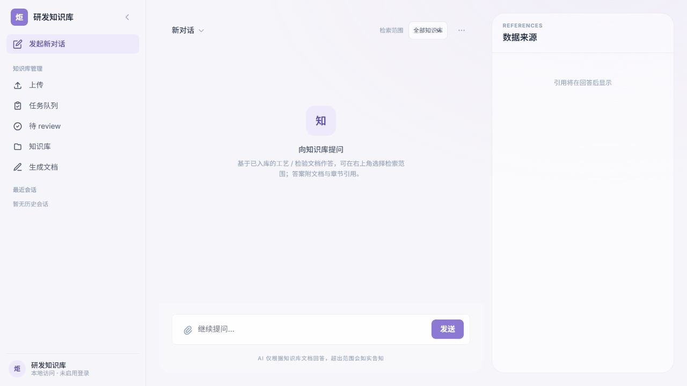
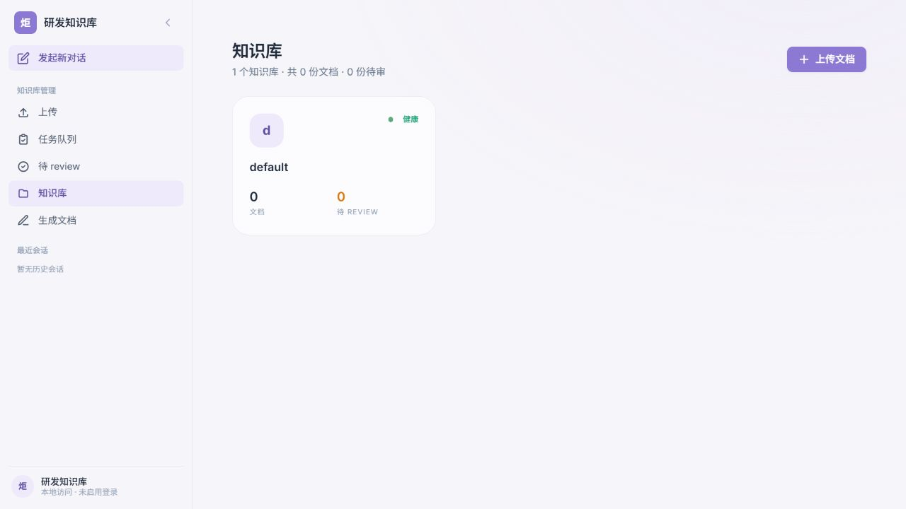
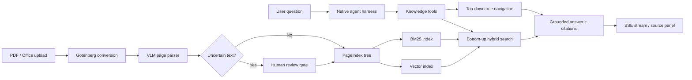

# Torch Knowledge Base

An enterprise-oriented knowledge assistant for R&D process and inspection documents. It turns PDF and Office files into a structured, searchable knowledge base, then uses a bounded agent runtime to answer questions with document-level and section-level citations.

The project focuses on the engineering around an AI application: multimodal ingestion, hierarchical indexing, hybrid retrieval, tool execution, streaming, citation grounding, evaluation, and graceful degradation.

## Product preview

The screenshots below were captured from a locally running FastAPI instance backed by an isolated, empty data directory. No private documents or conversation history are included.

| Grounded chat workspace | Knowledge-base management |
|---|---|
|  |  |

The current UI is a production-wired single-page prototype served by FastAPI. A separate Next.js application is planned but is not part of this repository yet.

## What it does

- Ingests PDF, DOCX, XLSX, PPTX, TXT, RTF, ODT, and CSV files. Non-PDF inputs are normalized through Gotenberg/LibreOffice before entering one PDF pipeline.
- Parses scanned and digital PDFs with a VLM, preserving uncertain text as explicit `<notsure>` review items instead of silently accepting it.
- Builds a PageIndex hierarchy for top-down document navigation and creates BM25 plus vector indexes for bottom-up retrieval.
- Fuses keyword and semantic candidates with weighted Reciprocal Rank Fusion (RRF); embedding failures fall back to BM25.
- Runs a project-owned, bounded agent loop with parallel read-only tools, ordered tool-result replay, streaming events, citation collection, and grounded-source checks.
- Supports document browsing, reprocessing, review, source localization, blueprint-based draft generation, and versioned module-level editing with rollback.

## Architecture



The codebase uses feature-first modules. HTTP orchestration stays in routers, business behavior in services, and persistence in repositories; shared model and retrieval infrastructure lives under `app/core`.

## Measured evaluation

These are recorded measurements, not estimates. The retrieval comparison used a fixed 70-query dataset (63 answerable and 7 unanswerable cases), an 8-file evaluation corpus, `text-embedding-v4`, and identical RRF settings in two consecutive runs. Both runs produced the same ranking metrics.

| Variant | Hit@5 | Recall@5 | MRR@10 | nDCG@10 | Search P50 | Search P95 |
|---|---:|---:|---:|---:|---:|---:|
| BM25 | 87.3% | 80.7% | 70.7% | 72.0% | 0.86-0.87 ms | 1.15-1.22 ms |
| BM25 + Vector + RRF | 90.5% | 86.0% | 80.2% | 81.0% | 364.32-375.68 ms | 412.09-415.13 ms |

Hybrid retrieval improved MRR@10 by 9.4 percentage points and nDCG@10 by 9.0 points, with a measured latency cost from remote embedding. The bootstrap 95% confidence intervals were `+4.2 to +15.4 pp` for MRR@10 and `+4.7 to +13.8 pp` for nDCG@10.

The agent evaluation executed 50 questions three times each (150 runs): 100% completed without exceptions, 90% met the run-success condition, and 415/415 cited handles were grounded in retrieved sources. Citation precision was 52.5% and citation recall was 92.7%, so citation selectivity remains an explicit improvement area rather than a hidden limitation.

Full manifests, metric definitions, dataset hashes, corpus/index fingerprints, and redacted results are available in:

- [`backend/evals/README.md`](backend/evals/README.md)
- [`retrieval run 1`](backend/evals/reports/retrieval-test-groups-c31e0eeb-run1/report.md)
- [`retrieval run 2`](backend/evals/reports/retrieval-test-groups-c31e0eeb-run2/report.md)
- [`agent evaluation`](backend/evals/reports/agent-test-88ab8fae-20260823/report.md)

The recorded evaluation manifests identify a dirty working tree at the evaluated Git SHA. Treat the numbers as reproducible project evidence, not a release benchmark, until a clean-commit rerun is published.

## Tech stack

- Python 3.11, FastAPI, SQLModel, Pydantic v2
- Project-owned agent harness with LangChain model/tool adapters
- PageIndex, BM25, vector search, weighted RRF
- OpenAI-compatible LiteLLM proxy for chat, vision, and embeddings
- Gotenberg/LibreOffice for Office-to-PDF conversion
- SQLite for v0; file-backed catalogs, trees, indexes, tasks, and conversations
- RapidOCR/ONNX Runtime for optional PDF source highlighting
- pytest, Ruff, and Pyright

## Repository layout

```text
backend/
  app/core/             Shared configuration, parsing, PageIndex, and retrieval
  app/modules/          Ingest, chat, document generation, and document editing
  app/shared/           Cross-module contracts and exceptions
  evals/                Versioned datasets, runners, scoring, and redacted reports
  tests/                Unit and integration tests
product/                Product requirements and the wired UI prototype
decisions/              Architecture Decision Records
docs/                   Stable design and implementation documentation
```

## Run locally

### Prerequisites

- Python 3.11
- [`uv`](https://docs.astral.sh/uv/)
- Docker, only when testing Office-file conversion
- An OpenAI-compatible LiteLLM endpoint and model credentials for VLM parsing, embeddings, and chat

The health endpoint, UI shell, and automated tests run without model credentials. Model-backed ingestion and answers require the environment values below.

### 1. Install dependencies

```bash
cd backend
uv sync
```

### 2. Configure the application

```bash
cp .env.example .env
```

Set at least these values for the complete workflow:

```dotenv
LITELLM_BASE_URL=https://your-proxy.example.com
LITELLM_API_KEY=replace-me
LITELLM_DEFAULT_VLM_MODEL=your-vision-model
INDEX_MODEL=your-index-model
CHAT_MODEL=your-chat-model
```

Do not commit `.env` or production documents.

### 3. Start document conversion (optional)

Required only for non-PDF uploads:

```bash
docker compose up -d gotenberg
```

### 4. Start the API and UI

```bash
uv run uvicorn app.main:app --reload
```

Open:

- UI: `http://localhost:8000/`
- OpenAPI: `http://localhost:8000/docs`
- Health check: `http://localhost:8000/health`

Expected health response:

```json
{"status": "ok"}
```

### 5. Verify the repository

```bash
uv run pytest -q
uv run ruff check .
uv run pyright
```

On 2026-08-25, the current local working tree produced `495 passed, 1 skipped` in 31.52 seconds. Ruff found one import-order issue in a test, while Pyright reported four third-party typing mismatches in the optional OCR path; those static-analysis findings remain open and are not represented as passing checks.

## Reproduce the retrieval comparison

Evaluation datasets must be manually labeled against source documents; the evaluated retriever must not generate its own gold labels. From `backend/`:

```bash
uv run python -m evals.validate_retrieval_datasets

uv run python -m evals.runners.retrieval_ab \
  --dataset evals/datasets/retrieval_test.jsonl \
  --data-dir data_eval/qwen37max_tree_full \
  --output-dir evals/reports/retrieval-local
```

Use the same embedding model and vector signature that created the index. Raw `results.json` files may contain evaluation questions, so they are ignored by Git; the Markdown report is the intended publishable artifact.

## Current scope

This is a v0, single-node engineering project rather than a finished multi-tenant SaaS product. Authentication/RBAC is still represented by a development user, Postgres and durable distributed workers are future work, and the UI has not yet been separated into its planned Next.js application. These boundaries are documented so the repository demonstrates implemented behavior without overstating production readiness.

## Design references

- [`ADR-003: PageIndex + hybrid retrieval`](decisions/ADR-003-retrieval.md)
- [`ADR-004: native agent runtime`](decisions/ADR-004-native-agent-runtime.md)
- [`Current implemented features`](docs/current-implemented-features.md)
- [`Hybrid retrieval design`](docs/plans/2026-06-24-hybrid-retrieval-design.md)

