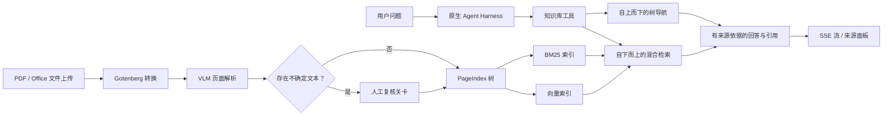

# 火炬知识库

<p align="center">
  <a href="README.md">English</a> | <strong>中文</strong>
</p>

面向企业研发工艺与检验文档的知识助手。系统将 PDF 和 Office 文件转化为结构化、可检索的知识库，并通过有边界的 Agent 运行时回答问题，提供文档级与章节级引用。

本项目重点展示 AI 应用外围的工程能力：多模态入库、层次化索引、混合检索、工具执行、流式响应、引用溯源、评测和优雅降级。

## 产品预览

下方截图来自本地运行的 FastAPI 实例，使用隔离的空数据目录，不包含任何私有文档或对话历史。

| 有来源依据的对话工作区 | 知识库管理 |
|---|---|
|  |  |

当前界面是由 FastAPI 提供服务、已接入真实后端的单页原型。独立的 Next.js 应用仍在规划中，尚未包含在本仓库内。

## 功能概览

- 支持 PDF、DOCX、XLSX、PPTX、TXT、RTF、ODT 和 CSV 文件入库。非 PDF 文件先通过 Gotenberg/LibreOffice 统一转换，再进入同一套 PDF 处理流水线。
- 使用 VLM 解析扫描版和数字版 PDF，将不确定文本显式保留为 `<notsure>` 待复核项，而不是静默接受识别结果。
- 构建 PageIndex 层次结构用于自上而下的文档导航，同时创建 BM25 与向量索引用于自下而上的检索。
- 通过加权倒数排名融合（Reciprocal Rank Fusion，RRF）合并关键词与语义候选结果；embedding 失败时自动回退至 BM25。
- 运行项目自研的有边界 Agent 循环，支持只读工具并行执行、工具结果按序回放、流式事件、引用收集和来源一致性检查。
- 支持文档浏览、重新处理、人工复核、来源定位、基于蓝图生成草稿，以及带回滚能力的模块级版本化编辑。

## 系统架构



代码库采用 feature-first 模块化结构。HTTP 编排位于 router，业务行为位于 service，持久化逻辑位于 repository；共享模型和检索基础设施位于 `app/core`。

## 实测评估

以下为实际记录的测量结果，而非估算。检索对比使用固定的 70 条查询数据集（63 条可回答、7 条不可回答）、8 份文件组成的评测语料、`text-embedding-v4`，并在连续两次运行中采用相同的 RRF 配置。两次运行得到一致的排名指标。

| 方案 | Hit@5 | Recall@5 | MRR@10 | nDCG@10 | 检索 P50 | 检索 P95 |
|---|---:|---:|---:|---:|---:|---:|
| BM25 | 87.3% | 80.7% | 70.7% | 72.0% | 0.86-0.87 ms | 1.15-1.22 ms |
| BM25 + 向量 + RRF | 90.5% | 86.0% | 80.2% | 81.0% | 364.32-375.68 ms | 412.09-415.13 ms |

混合检索使 MRR@10 提高了 9.4 个百分点、nDCG@10 提高了 9.0 个百分点，同时也因远程 embedding 引入了可观测的延迟成本。Bootstrap 95% 置信区间分别为：MRR@10 `+4.2 至 +15.4 个百分点`，nDCG@10 `+4.7 至 +13.8 个百分点`。

Agent 评测对 50 个问题各执行 3 次（共 150 次运行）：100% 无异常完成，90% 满足运行成功条件，引用的 415/415 个句柄均可在检索来源中定位。引用精确率为 52.5%，引用召回率为 92.7%；因此，引用选择性仍是明确的改进方向，而不是被隐藏的限制。

本地评测工作区保存了完整清单、指标定义、数据集哈希、语料与索引指纹，以及脱敏后的结果，但这些产物尚未进入公开提交。已记录的评测清单还表明，被评测 Git SHA 对应的工作区当时包含未提交改动。因此，在基于干净提交的复测结果与脱敏报告一并发布前，应将这些数字视为可复现的项目证据，而不是正式版本基准。

## 技术栈

- Python 3.11、FastAPI、SQLModel、Pydantic v2
- 项目自研 Agent Harness，使用 LangChain 作为模型和工具适配层
- PageIndex、BM25、向量检索、加权 RRF
- 通过 OpenAI 兼容的 LiteLLM Proxy 调用对话、视觉和 embedding 模型
- 使用 Gotenberg/LibreOffice 完成 Office 到 PDF 的转换
- v0 使用 SQLite；目录、树、索引、任务和对话采用文件持久化
- RapidOCR/ONNX Runtime 用于可选的 PDF 来源高亮
- pytest、Ruff 和 Pyright

## 仓库结构

```text
backend/
  app/core/             共享配置、解析、PageIndex 与检索
  app/modules/          入库、对话、文档生成与文档编辑
  app/shared/           跨模块契约与异常
  evals/                版本化数据集、运行器、评分与脱敏报告
  tests/                单元测试与集成测试
product/                产品需求与已接入后端的 UI 原型
decisions/              架构决策记录
docs/                   稳定的设计与实施文档
```

## 本地运行

### 前置条件

- Python 3.11
- [`uv`](https://docs.astral.sh/uv/)
- Docker，仅在测试 Office 文件转换时需要
- 一个 OpenAI 兼容的 LiteLLM 端点，以及 VLM 解析、embedding 和对话所需的模型凭据

健康检查接口、UI 外壳和自动化测试无需模型凭据即可运行。模型驱动的入库与问答需要配置下述环境变量。

### 1. 安装依赖

```bash
cd backend
uv sync
```

### 2. 配置应用

```bash
cp .env.example .env
```

要运行完整流程，至少需要设置：

```dotenv
LITELLM_BASE_URL=https://your-proxy.example.com
LITELLM_API_KEY=replace-me
LITELLM_DEFAULT_VLM_MODEL=your-vision-model
INDEX_MODEL=your-index-model
CHAT_MODEL=your-chat-model
```

不要提交 `.env` 或生产文档。

### 3. 启动文档转换服务（可选）

仅非 PDF 文件上传时需要：

```bash
docker compose up -d gotenberg
```

### 4. 启动 API 与 UI

```bash
uv run uvicorn app.main:app --reload
```

打开：

- UI：`http://localhost:8000/`
- OpenAPI：`http://localhost:8000/docs`
- 健康检查：`http://localhost:8000/health`

预期的健康检查响应：

```json
{"status": "ok"}
```

### 5. 验证仓库

```bash
uv run pytest -q
uv run ruff check .
uv run pyright
```

截至 2026-08-25，当前本地工作区运行结果为 `495 passed, 1 skipped`，耗时 31.52 秒。Ruff 在一项测试中发现 1 个 import 排序问题，Pyright 在可选 OCR 路径中报告 4 个第三方类型不匹配；这些静态分析问题仍未解决，因此未被描述为通过检查。

## 复现检索对比

评测数据集必须根据源文档进行人工标注；被评测的检索器不得自行生成其金标准标签。在 `backend/` 目录下运行：

```bash
uv run python -m evals.validate_retrieval_datasets

uv run python -m evals.runners.retrieval_ab \
  --dataset evals/datasets/retrieval_test.jsonl \
  --data-dir data_eval/qwen37max_tree_full \
  --output-dir evals/reports/retrieval-local
```

请使用与创建索引时相同的 embedding 模型与向量签名。原始 `results.json` 文件可能包含评测问题，因此已被 Git 忽略；Markdown 报告是预期公开发布的产物。

## 当前范围

本项目是 v0 单节点工程项目，并非已经完成的多租户 SaaS 产品。身份认证与基于角色的访问控制（RBAC）目前仍由开发用户模拟；Postgres 和可持久化的分布式 worker 属于后续工作；UI 尚未拆分为规划中的独立 Next.js 应用。明确记录这些边界，是为了让仓库如实展示已实现的行为，而不过度宣称生产就绪程度。

## 设计参考

- [`ADR-003：PageIndex + 混合检索`](decisions/ADR-003-retrieval.md)
- [`当前已实现功能`](docs/current-implemented-features.md)
- [`混合检索设计`](docs/plans/2026-06-24-hybrid-retrieval-design.md)
